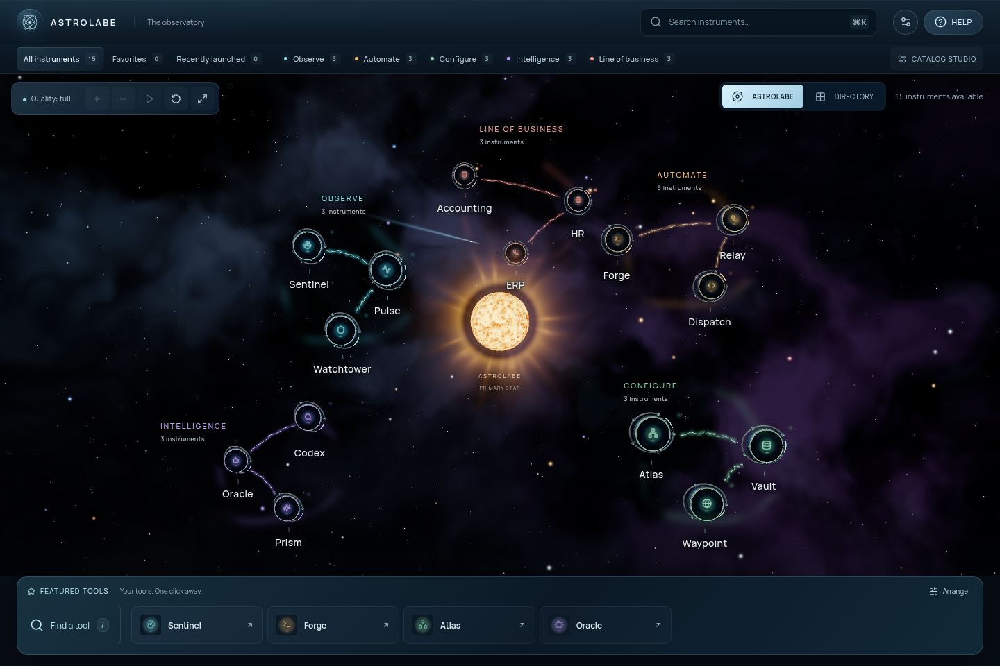
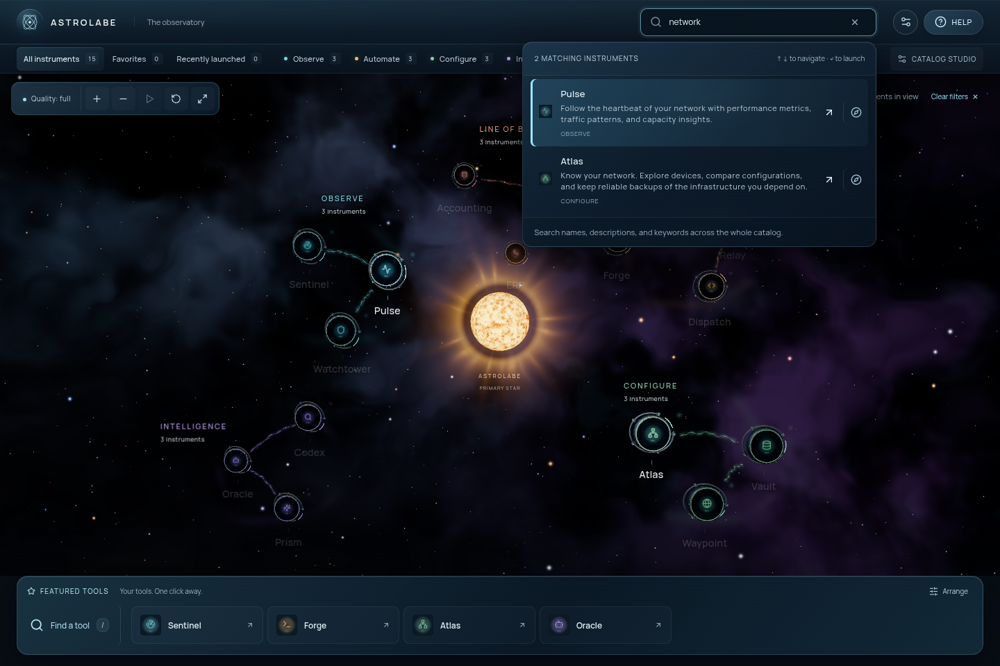
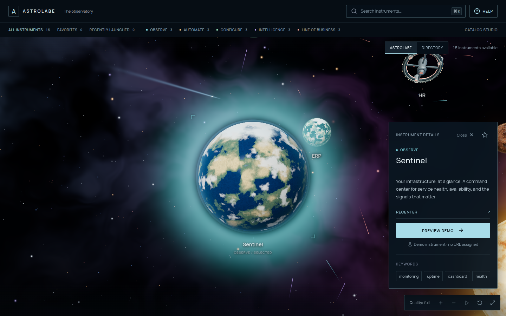
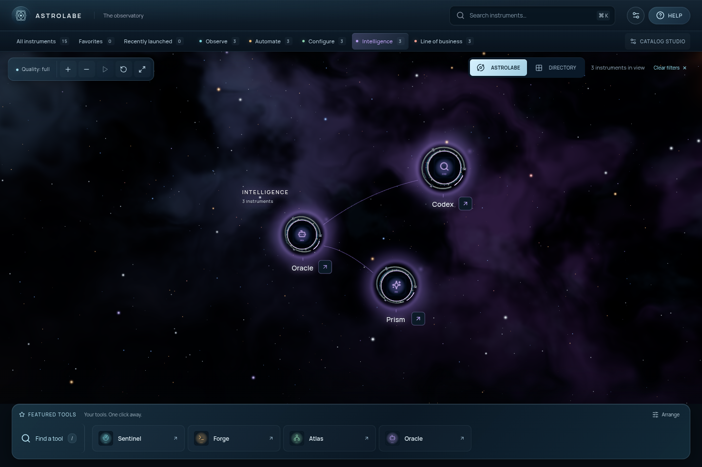
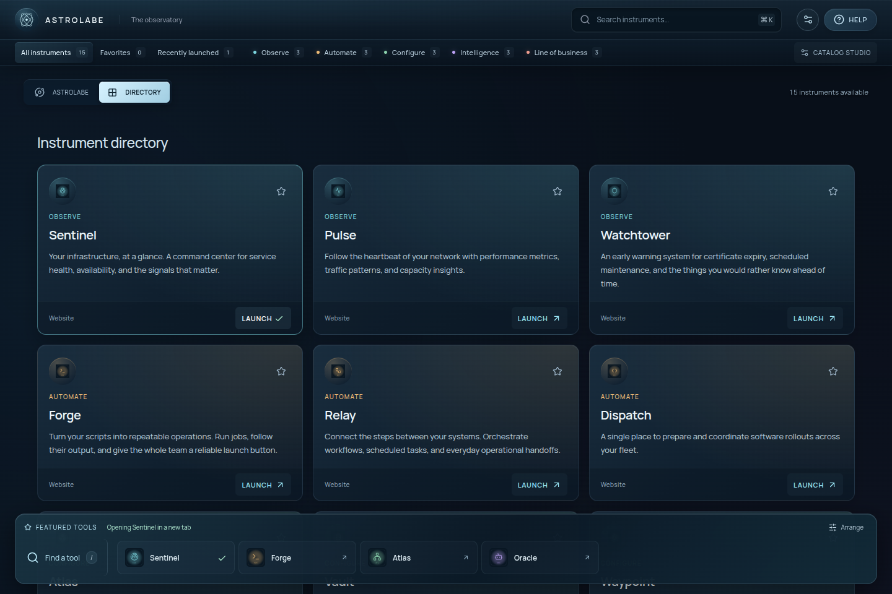
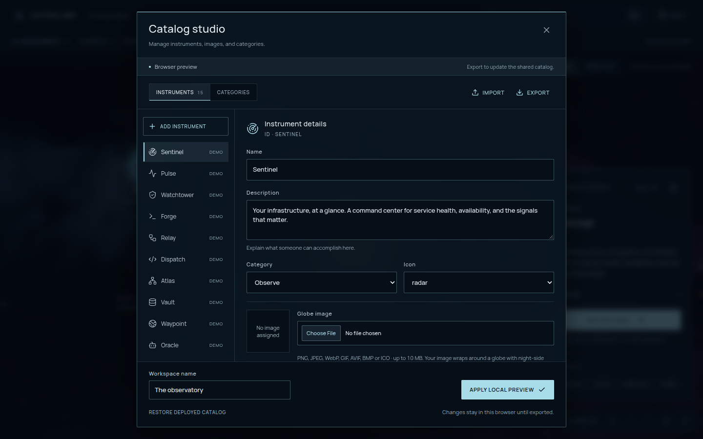
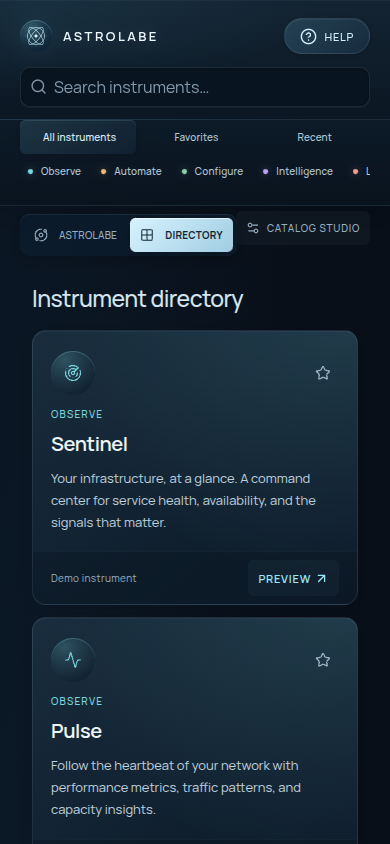
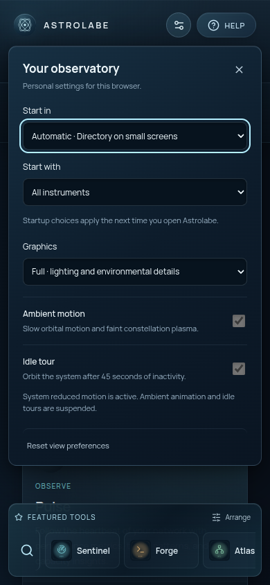
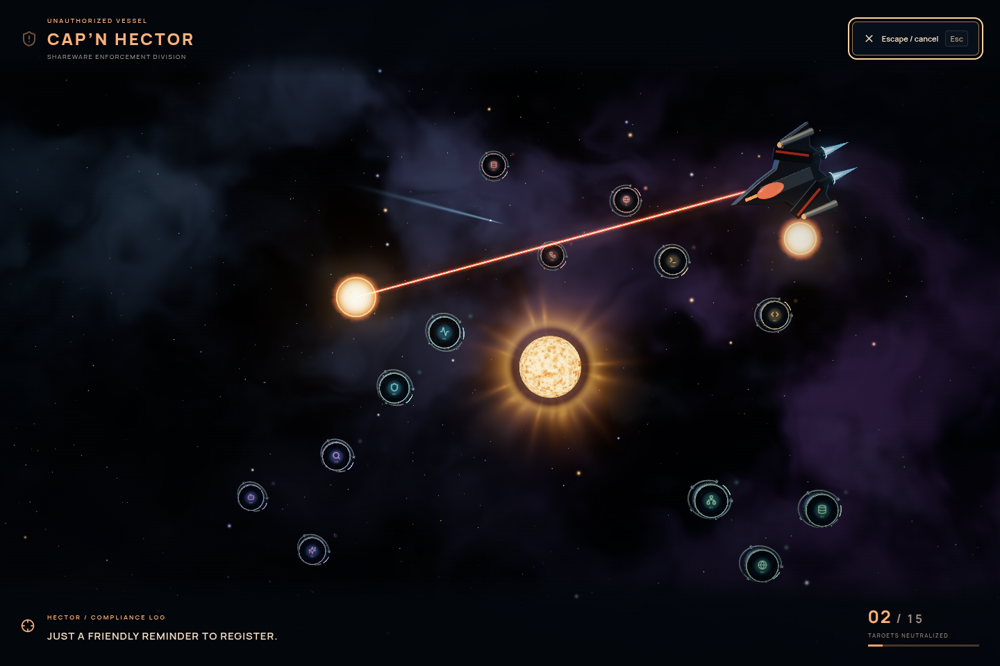

# Astrolabe

A self-hostable link portal for your department’s tools, presented as a space observatory. Search by task, launch a favorite, browse the complete Directory, or explore the constellations.



## What it offers

- **Find and launch:** task descriptions, keywords, typo-tolerant search, keyboard shortcuts, and direct links from search, Directory, scene labels, and the persistent launchpad.
- **Your tools in orbit:** uploaded logos remain readable inside detailed orbital housings. Faint plasma wisps and connecting filaments group related sites; category labels frame each constellation.
- **Inspect beside the scene:** tool details open alongside the selected destination on larger screens and below the scene on phones. The destination and its animation remain visible.
- **A personal launchpad:** pin and reorder favorites, return to recent tools, and preview descriptions by hovering or focusing a tool.
- **A view that suits you:** choose your startup view and collection, graphics quality, ambient motion, and idle tours. Reduced motion and a complete Directory fallback keep tools accessible.
- **A catalog you control:** edit tools and categories, upload images, import/export JSON, preview changes locally, or publish live with the included server.

The included catalog contains 15 fictional instruments across five editable categories. All sample URLs are `null`, so launching a sample opens a clearly marked demo preview. Add your own HTTP/HTTPS destinations through Catalog studio or by editing `public/catalog.json`. A small Node.js server supports live catalog saves; static hosting also works with import/export and local previews. There are no built-in accounts, live health checks, or shared preference database.

## Run locally

Use Node.js 22.12+ on the 22.x release line, or Node.js 24.x, with npm. These versions satisfy the locked Vite and Vitest requirements. The Docker build uses Node.js 22.

```sh
npm ci
npm run dev
```

Open the URL Vite prints (normally http://127.0.0.1:5173). To test from another device on your network, explicitly bind with `npm run dev -- --host 0.0.0.0`.

To build and inspect the production bundle:

```sh
npm run build
npm run preview
```

Preview serves `dist/` on the URL Vite prints (normally http://127.0.0.1:4173). It requires a build first and is intended for local verification. Development supports live saves to `public/catalog.json`. Vite preview and static hosting support local previews and import/export. To run the production server with live saving, build and run `npm start` (http://localhost:8080); it serves `dist/` and uses `public/catalog.json` as the writable catalog.

### Checks

```sh
npm test
npm run test:server
npx prettier --check README.md
```

Unit tests cover catalog validation and search, portable image validation, personal preferences, constellation placement and plasma connections, camera movement, focus framing, and HUD label projection.

For browser tests, install Playwright’s Chromium unless a usable Chrome/Chromium executable is already available:

```sh
npx playwright install chromium
npm run test:e2e
```

On Linux, `npx playwright install --with-deps chromium` also installs required system libraries. The browser configuration prefers `PLAYWRIGHT_CHROMIUM_EXECUTABLE_PATH`, then `/usr/bin/google-chrome`, then bundled Chromium. The browser test script builds the production bundle for isolated live-save tests. Playwright starts a Vite development server on `127.0.0.1:4173` automatically. To test an already running deployment instead, set `ASTROLABE_TEST_BASE_URL`, for example:

```sh
ASTROLABE_TEST_BASE_URL=http://127.0.0.1:8080 npm run test:e2e
```

Browser tests cover scene selection, camera controls and boundaries, label stability, search and native link launching (including middle-click), keyboard inspection and focus return, favorites, catalog editing/import/export, live saves and cross-browser updates, destination images, launchpad ordering, responsive layouts, reduced motion, and WebGL fallback. They use software-rendering flags for Chromium; assess graphics performance separately on the devices that will run the portal.

`npm run format` formats source, tests, configuration, the sample catalog, and this README in place.

## Populate your universe

The shared source of truth is **`public/catalog.json`**. It is fetched at runtime, independently of the JavaScript bundle. The 3D view, Directory, search results, instrument details, and launchpad read the same validated catalog. A valid deployed catalog must load before a saved browser preview can be restored.

1. Open **Catalog studio** from the navigation, beside the view switcher on phones.
2. Edit a sample or choose **Add instrument**. Supply a name, useful description, category, icon, and URL. Add comma-separated search keywords as needed; leave the keyword field empty for no tags. Leave the URL blank for a demo preview. Feature a tool to make it eligible for the initial launchpad.
3. Use **Categories** to change category names, colors, descriptions, and icons, or create a category. Reassign its instruments before deleting a category.
4. Choose **Apply local preview** to try the changes. This saves an override in this browser’s local storage and displays a persistent preview banner. Other browsers still see the deployed catalog.
5. Choose **Save** to update the shared JSON immediately, clear this browser’s preview, and apply the catalog in all connected browsers without reloading. An older editor draft cannot overwrite a newer shared save; export your draft and restore the latest catalog before merging changes.
6. On static hosting, choose **Export**, then replace `public/catalog.json` with the downloaded file. Publish it using the Docker or static-server workflow below. Export validates the editor draft and does not require applying a local preview first.

**Import** validates an existing JSON catalog before replacing the editor’s draft. **Restore deployed catalog** removes this browser’s preview and restores the latest shared catalog received by the page. Live updates preserve active local previews and unsaved editor drafts. On static hosting, reload the page first after changing the server file; Save is unavailable there.

Catalog studio is accessible to any visitor. With the Node.js server, any visitor who can reach the save endpoint can publish changes; use your reverse proxy/SSO to restrict the portal or protect `PUT /api/catalog` to limit publishing. Saves use the same schema validation as the editor and atomically replace the file before broadcasting a live update. Local previews, favorites, recent launches, and graphics quality are stored per browser origin and are not synchronized between devices. If browser storage is unavailable or full, changes may last only for the current session; export your catalog to keep it.

### Catalog format

```json
{
  "version": 1,
  "title": "The observatory",
  "categories": [
    {
      "id": "configure",
      "name": "Configure",
      "description": "Bring order to your infrastructure",
      "color": "#8bd1ad",
      "icon": "network"
    }
  ],
  "sites": [
    {
      "id": "network-atlas",
      "name": "Network Atlas",
      "description": "Back up switch configurations and compare changes.",
      "category": "configure",
      "icon": "network",
      "url": "https://ncm.example.internal/",
      "tags": ["ncm", "switch", "router", "backup", "config"],
      "featured": true
    }
  ]
}
```

The schema and runtime validation live in [`src/lib/catalog.ts`](src/lib/catalog.ts). All fields shown above are required; `image` is optional on an instrument. The top-level collection is named `sites`, although the interface calls its entries instruments.

| Field                             | Validation                                                                                                    |
| --------------------------------- | ------------------------------------------------------------------------------------------------------------- |
| `version`                         | Must be `1`.                                                                                                  |
| `title`                           | Nonblank, at most 80 characters.                                                                              |
| `categories`                      | 1–12 entries.                                                                                                 |
| `sites`                           | 0–200 entries, each referencing an existing category ID.                                                      |
| Category and instrument `id`      | 1–64 lowercase letters, digits, or hyphens; must start with a letter or digit. Unique within each collection. |
| Category `name` / `description`   | Nonblank, at most 40 / 160 characters.                                                                        |
| Category `color`                  | Six-digit hex value, such as `#8bd1ad`.                                                                       |
| Instrument `name` / `description` | Nonblank, at most 80 / 300 characters.                                                                        |
| Instrument `url`                  | Absolute HTTP/HTTPS URL without embedded credentials, at most 2048 characters, or `null` for a demo.          |
| Instrument `tags`                 | Up to 16 nonblank strings, at most 40 characters each; `[]` is valid.                                         |
| Instrument `featured`             | Required boolean.                                                                                             |

Keep IDs stable because favorites and launch history refer to them. Both category and instrument `icon` fields accept: `radar`, `network`, `terminal`, `bot`, `activity`, `shield`, `workflow`, `database`, `code`, `search`, `globe`, `sparkles`.

### Destination images

In **Catalog studio → Instruments → Destination image**, upload PNG, JPEG, WebP, GIF, AVIF, BMP, or ICO files up to 10 MiB (8192 pixels per side / 32 megapixels maximum). Browser decoding and Canvas resampling normalize them to a square WebP thumbnail, at most 512 × 512 with a complete data URL of at most 128 KiB; JPEG is the fallback when WebP encoding is unavailable. Images retain their aspect ratio, fit within a dark padded surface, and lose embedded metadata. Animated formats use a still frame. No upload server or ImageMagick installation is required.

Assigned images become illuminated emblems inside dimensional orbital housings. The complete image faces the camera, preserving logos without spherical distortion or night-side shading. Category-colored rings and slowly moving mechanical details surround the artwork; each instrument ID determines its housing variant. Existing embedded catalog images work automatically, with no migration or reupload. Tools without images retain their procedural planets and stations. **Remove destination image** restores the original model. Existing node images can also be assigned to another instrument. Thumbnails appear in the editor, search, and Directory.

The optional instrument `image` field stores a normalized PNG/JPEG/WebP data URL inside the catalog. Save publishes it to the shared catalog; Apply local preview keeps it in this browser. Export/import includes the images with no separate asset files. Catalog studio’s file importer accepts up to 28 MiB. Browser storage has a smaller browser-dependent quota: if a preview cannot be persisted, the editor explicitly reports a session-only preview and prompts export. Uploaded originals are never retained. Invalid image decoding leaves a category-colored placeholder inside the orbital housing without taking down the scene.

The schema accepts up to 200 instruments, but the included 3D layout is demonstrated with 15. Schema limits do not guarantee a readable or performant 3D scene at maximum capacity. Use Directory for larger collections and evaluate your catalog on target devices.

## Self-host

### Docker

Requires Docker Engine and the Docker Compose plugin. From the repository root:

```sh
ASTROLABE_USER="$(id -u):$(id -g)" docker compose up --build -d
```

Open http://localhost:8080. Compose builds the frontend and runs the Node.js server with your host UID/GID so it can write the mounted catalog. It mounts the `public/` directory at `/app/catalog` so **Save** persists to the host’s `public/catalog.json` and survives container recreation. `ASTROLABE_USER` defaults to `1000:1000` if omitted; set it to the owner of `public/` (or persist it in your Compose `.env`). The directory and file must be writable by that user. Mount the directory rather than a single file: saving uses atomic file replacement.

Save changes in Catalog studio; no rebuild or reload is needed. Valid direct edits to the mounted catalog are also broadcast to connected browsers. For application code or dependency changes, repeat the build/start command above.

```sh
docker compose logs -f astrolabe
docker compose down
```

The server serves `catalog.json` and the catalog API with `Cache-Control: no-store`, hashed assets with a one-year immutable cache, and other responses with `no-cache`. The container health check requests the web root; it does not validate linked applications. Preserve the original Host header in a reverse proxy so same-origin Save requests can be verified. When proxying live updates, disable buffering for `/api/catalog/events` and allow long-lived SSE connections.

For a Node.js deployment without Docker, run `npm ci`, `npm run build`, and `npm start`. Optional environment variables: `PORT` (8080), `HOST` (`0.0.0.0`), `STATIC_DIR` (`dist`), and `CATALOG_PATH` (`public/catalog.json`). Paths are relative to the working directory unless absolute. The runtime server has no npm dependencies and shares the frontend’s catalog validator.

### Any static web server

Run `npm run build` and serve the contents of `dist/` at your domain’s root with Nginx, Caddy, or an existing web server. Keep `catalog.json` uncached; [`nginx.conf`](nginx.conf) provides the included caching configuration. To publish only catalog changes, replace the served `catalog.json` directly, or update `public/catalog.json`, rebuild, and redeploy `dist/`. Reload clients to fetch the new catalog, and restore the deployed catalog if a local preview is active.

Fonts and generated graphics are served locally; static hosting requires no runtime CDN, analytics, or backend API. Live Save requires the included Node.js server. Real destinations open in a new tab and handle their own authentication. Put the portal behind your usual reverse proxy/SSO if access to the directory should be restricted.

## Interaction and accessibility

Choose **Help** in the header (or press `?`) for a brief camera guide.

- **Orbit:** left-drag around the point where you press. Rotation is unrestricted, including over the poles. **Pan:** right-drag, middle-drag, or Shift-drag. **Zoom:** scroll toward the pointer, or use +/− at the current focus.
- **Select:** click an instrument or its name to focus and inspect it; click a category name to frame its group. Click or tap empty scene space, or press Escape, to close instrument details while keeping the current camera position. Hover or focus a tool name to reveal a launch arrow and preview its description in the dock. The arrow launches directly. Double-click a surface to move closer. A fresh gesture interrupts camera travel.
- **Fly:** click empty scene space, then use WASD to move, R/F or E/Q for up/down, arrow keys to aim, and Shift to boost. Flight stays inside the scene boundary.
- **Touch:** one finger orbits; two fingers pan and pinch to zoom. Tap an instrument’s name in the scene list to inspect it, or its separate arrow to launch directly.
- **Reset:** use Reset camera or Home to return to the overview. Reduced motion makes camera transitions immediate.

- Search with `Ctrl/⌘ K` or `/`. Results match every word across names, descriptions, category names/IDs, and keywords. Names and keywords also tolerate a single typo in words of at least four characters; exact matches rank first. Arrow keys select a result; Enter or clicking its name launches it immediately. Search results include task descriptions, and a separate Inspect button opens details. Search quietly emphasizes matching destinations without moving the camera or opening details automatically.
- Select a node to inspect it, then launch from the details panel. Scene inspection stays beside the animation, or below it on phones, without a modal backdrop. Small-screen Directory inspection uses a focused dialog. Keyboard inspection focuses the launch control; closing details returns focus to the originating control. Pointer inspection preserves the current focus. Directory and the launchpad provide direct links.
- Real destinations use native links, including middle-click and browser context menus. Launching briefly shows a check mark and an opening acknowledgement in the dock, also announced to screen readers. The destination opens immediately. Hover and keyboard focus independently preview tool descriptions; leaving a hovered tool restores the focused tool's description.
- Star instruments to personalize the persistent launchpad, available in both views and during 3D loading. Favorites appear in the order you add them; use Arrange to move or remove them. The dock scrolls horizontally for larger collections, falls back to up to six featured instruments when there are no favorites, and shows up to two additional recent tools on wide displays. Favorites and the 20 most recent distinct launches persist in this browser when storage is available, independently of the shared catalog.
- Directory is the default initial view below 900 pixels wide and the automatic fallback when WebGL 2 or scene initialization is unavailable. Switching to it unloads the 3D renderer.
- **View preferences** (the settings icon beside Help) lets each teammate choose a startup view and collection, graphics quality, ambient motion, and idle tours. Startup choices apply on the next visit; graphics and motion apply immediately. Preferences stay in this browser, independently of the shared catalog. Reset restores view defaults while retaining favorites, launch history, and catalog data. Storage failures leave preferences usable for the current session and show a notification.
- **Quality: light** disables bloom and dynamic shadows and reduces pixel density and star count. The preference persists locally. All tools remain available in both quality modes.
- **Idle tour:** after 45 seconds without input, the camera frames the complete system and slowly orbits it. Mouse, keyboard, or touch input immediately restores your previous camera position and focus. Tours can be disabled in View preferences. They wait for loading to finish and stay off while inspecting a tool, searching, filtering a collection/category, motion is paused, reduced motion is enabled, preferences or a dialog are open, or the tab is hidden.
- Ambient motion can be paused. OS reduced-motion preferences suppress it automatically. Keyboard focus, native modal focus trapping, a skip link, and named controls support operation without a mouse.

## Implementation

Styles have three owners: `src/appearance.css` defines typography, colors, and surfaces; `src/layout.css` defines geometry and responsive behavior; `src/motion.css` defines transitions, transforms, and keyframes. Keep new declarations in their corresponding file and retain reduced-motion support.

Constellations use faint category-colored plasma wisps and a sparse set of glowing ribbons between their actual sites. Each ribbon contains drifting strands, a brighter core, and a soft surrounding glow; its ends fade outside the destination silhouettes. These grouping cues have no click handlers or picking surfaces; category names remain the controls for framing a group. Empty categories add no field, and single-site groups add no connecting lines. The selected site's constellation stays illuminated while other groups dim. Search subdues the atmosphere, and pause and reduced motion freeze its flow.

Site nodes and the primary star are the scene's solid objects. Uploaded logos stay flat and readable inside layered, machined orbital housings with brushed surface detail, recessed grooves, fasteners, fine scale markings, and beveled mechanical parts. Warm key lighting, cool rim light, and locally generated reflection cards give the housings depth. A quieter corona and dust lanes in the distant nebula keep the foreground destinations prominent. Image uploads, category colors, and the catalog format work as before.

React 19, TypeScript, and Vite; Three.js through React Three Fiber. The [3D scene](src/components/Observatory.tsx) loads on demand, with locally generated geometry, shaders, and bundled fonts.

## Screenshots

Captured from the production build with Playwright at 1440 × 960 and 390 × 844. The gallery uses the fictional catalog with sample uploaded artwork and example URLs. These screenshot fixtures are not saved to `public/catalog.json`.

**Task search**

Search names, descriptions, categories, and keywords. Launch from the result or choose Inspect for details.



**Direct scene launch and tool description preview**


**Instrument focus and side inspection**



**Intelligence constellation with uploaded logos**



**Directory and launch acknowledgement**

The Directory offers the same tools as direct links. Opening a destination briefly shows a check mark and an acknowledgement in the launchpad.



**Catalog studio**



**Mobile Directory**



**Personal view preferences on mobile**



<details>
<summary>Spoiler: an uninvited visitor</summary>

With 3D available, type **`hector`** outside a text field to summon a procedural homage to [Cap’n Hector](https://evn.fandom.com/wiki/Hector) from Escape Velocity and Escape Velocity Nova. Hector flies straight into the scene without an opening transmission, destroys its destinations with lasers, guided missiles, fireballs, shockwaves, and debris, then departs with a lingering barrel roll before a slow restoration wipe.

The included catalog's sequence takes about 20 seconds after the scene is ready. Larger catalogs receive simultaneous target groups, with at most twelve volleys. Normal controls are locked during the film; the always-visible **Escape / cancel** button and the Escape key begin the same restoration wipe immediately. The existing Reset camera transition restores the overview, then controls unlock. The catalog, mapped images, favorites, history, and saved view settings stay intact.

Typing in search or editors never activates it. Reduced motion removes camera shake and the barrel roll, steadies the beams and flight, and replaces the moving wipe with a fade. Leaving the tab pauses the sequence.



</details>
